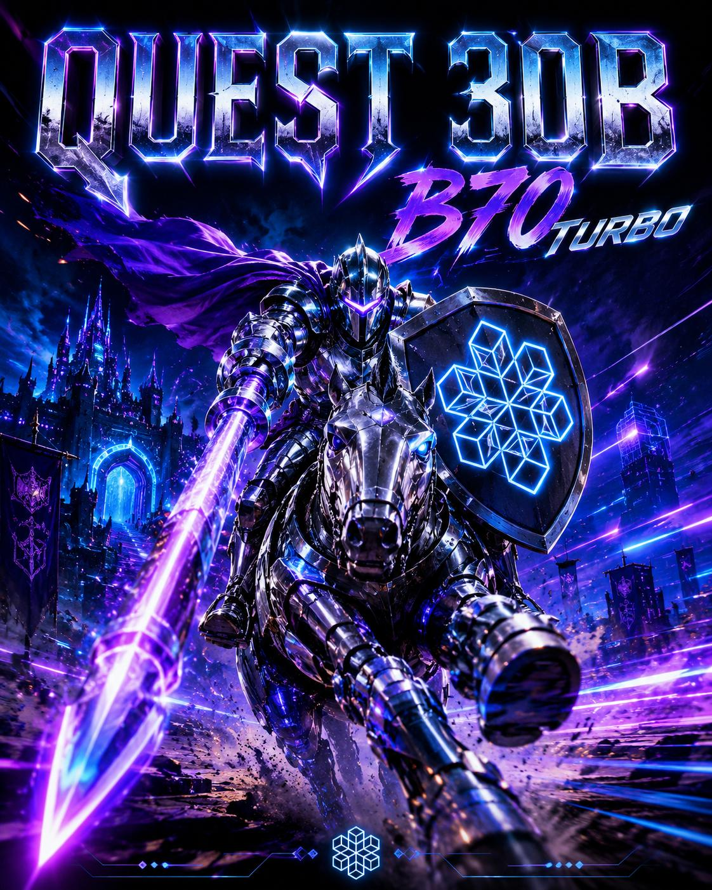

# QUEST-30B-RL Turbo



Intel Arc (B70) / `llama.cpp` SYCL packaging of
[**`osunlp/QUEST-30B-RL`**](https://huggingface.co/osunlp/QUEST-30B-RL) — fetch → imatrix → quantize →
**agentic gate** → speed-tune → serve, with a reusable certification suite. Ships **Q5_K_M**.

## Facts (measured)

| | |
|---|---|
| Quant | `Q5_K_M` · 20.2 GB · imatrix · fits one ~30 GiB Arc GPU at `-ngl 99` |
| Base | `qwen3moe` MoE · 48L · 128E/8A · ~30.5B/3.3B active · ctx 262144 · `<think>` + tool-calling |
| Perplexity | 7.19 (wikitext-2) |
| **Agentic gate vs BF16** | TOOL **8/9** · REASON **10/10** · THINK **10/10** → ✅ **PASS** (identical to BF16) |
| Speed (B70, measured E2E) | prefill **~1,380 tok/s**; decode **~80 tok/s** short-ctx, **~31 tok/s** @ 8K (MoE, 3.3B active) |
| `<think>` budget | spends heavily in reasoning — set `max_tokens` ≥ 1,500 or answers truncate |
| Released | [huggingface.co/Frosty40/QUEST-30B-RL-B70-Turbo-GGUF](https://huggingface.co/Frosty40/QUEST-30B-RL-B70-Turbo-GGUF) |

PPL is treated as necessary-but-insufficient; the **ship decision is the agentic gate** (tool-call
integrity + multi-step reasoning + `<think>` structure, graded against BF16) — for an RL'd agentic
model, quant damage shows up as behavior, not perplexity.

## Use

```bash
source env.sh
# reproduce a phase (00 baseline → 01 fetch → 02 imatrix → 03 quant → 04 ppl → 04b gate → 05 speed → 06 serve)
bash scripts/04b_agentic_gate.sh          # MODELS="Q5_K_M BF16" REF_LABEL=BF16  — the ship decision

# certify any quant with the standardized suite
cd tests && python -m pytest -q            # pure unit tests (no GPU)
bash certify.sh --quant Q5_K_M             # full GPU certification → PASS/FAIL (exit 0 = SHIP)

# serve
QUANT=Q5_K_M CTX=65536 KV=q8_0 bash scripts/06_serve.sh   # :8093, --jinja (think + tools)
```

See [`AUDIT.md`](AUDIT.md) for the plan and [`LOOP-STATE.md`](LOOP-STATE.md) for the campaign ledger.

---

## Credits & acknowledgements

This repo is a **thin quantization + runtime mod on top of substantial work by others.** Almost all
the value belongs to the teams below — please cite and support them first:

- **Model — [OSU NLP Group (`osunlp`)](https://huggingface.co/osunlp):**
  [`QUEST-30B-RL`](https://huggingface.co/osunlp/QUEST-30B-RL), the RL-trained deep-research / agentic
  model this packages. **All capability is theirs.** (Apache-2.0)
- **Base architecture — [Qwen, Alibaba](https://huggingface.co/Qwen):** Qwen3-30B-A3B, the MoE
  foundation QUEST is trained from. (Apache-2.0)
- **Inference engine — [`llama.cpp` / ggml-org](https://github.com/ggml-org/llama.cpp):** runtime,
  GGUF format, and the k-quant / importance-matrix tooling that make this build possible.
- **GPU backend — [Intel oneAPI / SYCL](https://www.intel.com/content/www/us/en/developer/tools/oneapi/overview.html)** for Arc.

**Our contribution** is only the thin layer on top — imatrix calibration, Q5_K_M quantization, the
agentic-fidelity gate, Arc/B70 SYCL speed-tuning, packaging, and the certification suite — by
[**Frosty40**](https://huggingface.co/Frosty40). Scripts & docs: **MIT**. Model weights: **Apache-2.0**,
inherited from the base model.

> If you use this, please cite **QUEST-30B-RL** (OSU NLP) and **Qwen3** (Qwen) first — this package
> would not exist without their work, or without `llama.cpp`.
