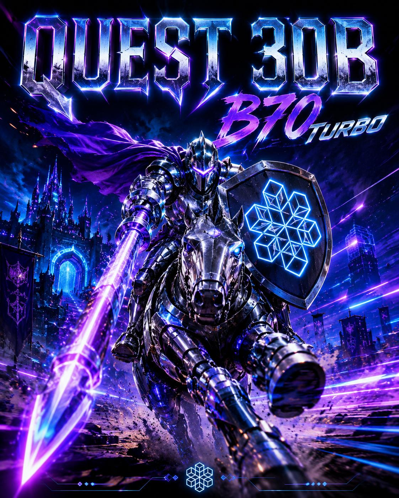

# QUEST-30B-RL — B70 Turbo (Q5_K_M GGUF)

An Intel Arc / `llama.cpp` (SYCL) GGUF build of
[**`osunlp/QUEST-30B-RL`**](https://huggingface.co/osunlp/QUEST-30B-RL) — imatrix-quantized to
**Q5_K_M** and **certified to behave like the BF16 source** on tool-calling and reasoning, not just
on perplexity.

| | |
|---|---|
| **File** | `quest-30b-rl-Q5_K_M.gguf` · 21,725,581,024 bytes · 20.23 GiB (21.73 GB) · imatrix Q5_K_M |
| **Base** | `osunlp/QUEST-30B-RL` — `qwen3moe` MoE, ~30.5B total / ~3.3B active, 128 experts/8 active, ctx 262144, `<think>` + tool-calling |
| **Fits** | one ~30 GiB Arc GPU at `-ngl 99` (full offload) |
| **Perplexity** | 7.19 (wikitext-2) |
| **Agentic gate vs BF16** | TOOL **8/9** · REASON **10/10** · THINK **10/10** → ✅ **PASS** (identical to BF16) |
| **Speed (B70, measured, ship config)** | prefill **~1,380 tok/s**; decode **~80 tok/s** short-context, **~31 tok/s** @ 8K ctx |

The quant is graded against the BF16 source on tool-routing, JSON-arg integrity, multi-step reasoning,
and `<think>` structure — Q5_K_M scores **identically to BF16** with no quant-induced regression.
A reusable certification suite (`certify.sh` → PASS/FAIL) ships in the pipeline repo.

**Performance is real-world measured** (served, end-to-end — not just `llama-bench`): decode holds
**~80 tok/s at short context**, **~31 tok/s at ~8K**, and falls further with depth (it's a 3.3B-active
MoE, so fast *for a 30B*, but long-context decode is attention-bound); prefill is **~1,380 tok/s**.
QUEST spends heavily inside `<think>` — **budget `max_tokens` ≥ 1,500** for reasoning, or the final
answer can be truncated.

## Run

```bash
llama-server -m quest-30b-rl-Q5_K_M.gguf -ngl 99 --port 8093 \
  -c 65536 -fa on --cache-type-k q8_0 --cache-type-v q8_0 \
  -ub 4096 -b 8192 --jinja --alias quest-30b-rl-turbo
```

`--jinja` is **required** (it enables `<think>` reasoning *and* tool-calling). Give agentic/reasoning
requests a real `max_tokens` (~4096) — the model spends tokens inside `<think>`.

**Pipeline + standardized certification suite:** [github.com/newjordan/quest-turbo](https://github.com/newjordan/quest-turbo)

---

## Credits & acknowledgements

This release is a **thin quantization + runtime mod on top of substantial work by others.** Almost all
the value here is theirs — please cite and support them first:

- **Model — [OSU NLP Group (`osunlp`)](https://huggingface.co/osunlp):**
  [`QUEST-30B-RL`](https://huggingface.co/osunlp/QUEST-30B-RL), the RL-trained deep-research / agentic
  model this build simply packages. **All capability is theirs.** (Apache-2.0)
- **Base architecture — [Qwen, Alibaba](https://huggingface.co/Qwen):** Qwen3-30B-A3B, the MoE
  foundation QUEST is trained from. (Apache-2.0)
- **Inference engine — [`llama.cpp` / ggml-org](https://github.com/ggml-org/llama.cpp):** the runtime,
  the GGUF format, and the k-quant / importance-matrix tooling that make this build possible.
- **GPU backend — [Intel oneAPI / SYCL](https://www.intel.com/content/www/us/en/developer/tools/oneapi/overview.html)**
  for Arc.

**Our contribution** is only the thin layer on top: imatrix calibration, the Q5_K_M quantization, an
agentic-fidelity gate, Arc/B70 SYCL speed-tuning, and packaging — by
[**Frosty40**](https://huggingface.co/Frosty40). Quantization scripts & docs: MIT.
**Weights: Apache-2.0, inherited from the base model.**

> If you use this model, please cite **QUEST-30B-RL** (OSU NLP) and **Qwen3** (Qwen) first — this
> package would not exist without their work, or without `llama.cpp`.
